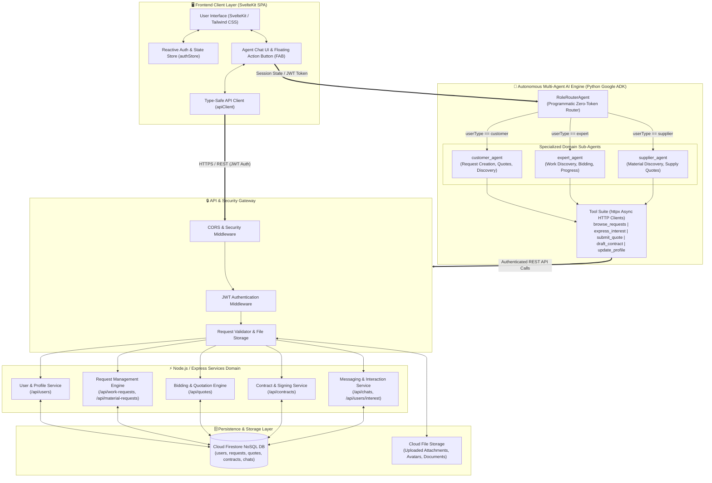
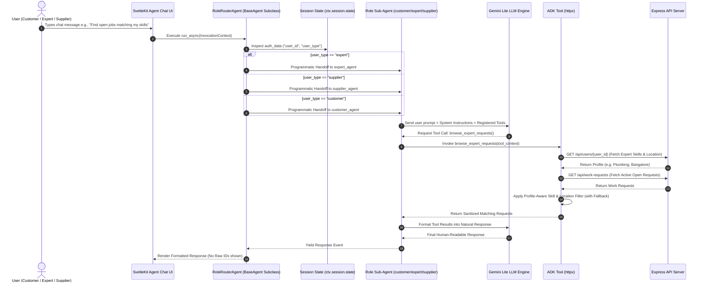
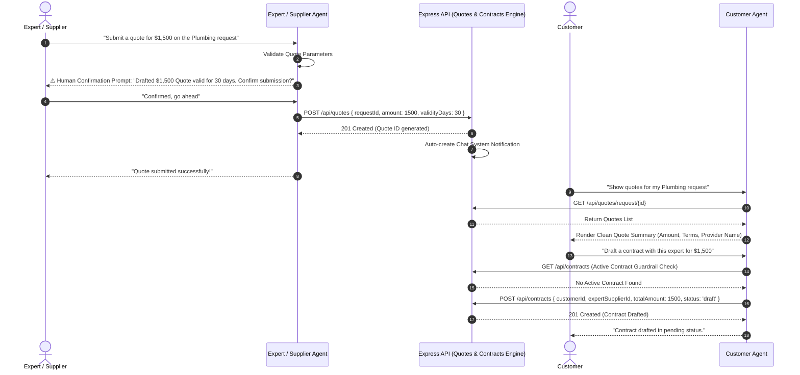

# System Architecture & Technical Design Document

> [!IMPORTANT]
> **CareRevenue Senior Full-Stack Engineer Interview Presentation**  
> **System Name**: GEFIFI AI-Powered Enterprise Marketplace & Automation Platform  
> **Key Capabilities Demonstrated**: Tech-Agnostic Full-Stack Engineering, Multi-Agent Autonomous Workflows, Programmatic Zero-Token Routing, Event-Driven Real-Time Sync, and Human-In-The-Loop Safety Guardrails.

---

## 1. Executive Summary & Architecture Strategy

This document details the production-ready architecture of **GEFIFI**, a modern full-stack platform designed to automate complex, multi-stakeholder workflows (Customers, Experts, Suppliers) using an autonomous **Multi-Agent AI Engine** integrated with an event-driven **Express.js API Backend** and a reactive **SvelteKit Single-Page Application (SPA)**.

### Alignment with CareRevenue (RCM & AI Automation Team)
* **Tech-Agnostic Microservices**: Decouples high-throughput Node.js API services from Python Google ADK AI Agent orchestration.
* **Cost & Latency Optimization**: Eliminates LLM routing overhead using programmatic `RoleRouterAgent` zero-token dispatch.
* **Human-In-The-Loop Safety**: Financial commitments (Quotes, Contracts, Status triggers) require explicit human confirmation.
* **Real-Time Communication**: Seamless bi-directional messaging and status synchronization across users and autonomous agents.

---

## 2. High-Level System Architecture Diagram

---

## 3. Comprehensive Deep-Dive Architecture & Data Flows

### A. Programmatic Multi-Agent Handoff Flow (Zero-Token Routing)

> [!NOTE]
> Instead of burning expensive LLM tokens to evaluate user roles, the `RoleRouterAgent` inspects the decoded JWT `userType` in session state and programmatically delegates execution in $O(1)$ time with zero model token usage.

---

### B. Human-In-The-Loop Quote Submission & Contract Negotiation Flow

---

## 4. Key Architectural Highlights & Interview Talking Points

### 1. Tech-Agnostic Decoupling (Node.js REST API + Python Agent Microservice)
* **Architecture Choice**: Built an Express.js API core in TypeScript for high-throughput, low-latency CRUD operations and auth validation, alongside a dedicated Python Google ADK service for autonomous AI agent logic.
* **Why for CareRevenue**: Demonstrates tech-agnostic thinking (selecting Node.js for rapid REST API development and Python for state-of-the-art AI agent orchestration).

### 2. $O(1)$ Zero-Token Programmatic Routing (`RoleRouterAgent`)
* **Problem**: Traditional multi-agent architectures use a primary "Supervisor LLM" to classify intent and route to sub-agents, wasting 300–800 LLM tokens per request and adding 1–2 seconds of latency.
* **Solution**: Subclassed ADK `BaseAgent` into `RoleRouterAgent`, overriding `_run_async_impl` to read the decoded JWT `userType` directly from `ctx.session.state` and route programmatically with **0 token cost** and **< 1ms routing delay**.

### 3. Graceful Fallbacks & Crash-Proof Data Pipelines
* **Resilience Pattern**: Profile lookup & filtering functions feature safe dictionary key access (`.get()`) to prevent `KeyError` runtime crashes on incomplete records.
* **Fallback Logic**: If strict criteria filtering returns zero items, discovery tools automatically relax constraints and return all active registered items accompanied by an informative notice, preventing dead-end UI states.

### 4. Human-In-The-Loop (HITL) Safety Guardrails
* **Financial & Legal Protection**: Actions with legal or financial consequences (drafting contracts, submitting quotes, updating active project statuses) are strictly guarded. Agents draft and validate the payload, present a structured confirmation, and execute only upon explicit user consent.
* **Active Contract Constraint Enforcer**: Validates `GET /api/contracts` before drafting to ensure only a single active contract exists per request at any point in time.

---

## 5. Interview Defense Guide: Anticipated Questions & Answers

| Question from CareRevenue Interviewer | How to Answer (Pitching GEFIFI Architecture) |
| :--- | :--- |
| **"How do you design scalable APIs and integrate front-end ↔ back-end auth?"** | *"In GEFIFI, auth is centralized via JWT Bearer tokens. The SvelteKit frontend injects the token into `apiClient` headers. The Express backend validates the token via middleware and attaches `req.user`. The Python ADK Agent reads the JWT payload directly from session state (`ctx.session.state['auth_data']`), maintaining complete security context across the stack."* |
| **"How do you handle AI agent performance, latency, and cost control?"** | *"I designed a programmatic router (`RoleRouterAgent`) that bypasses LLM intent classification for role dispatch. By reading user claims directly from state, we save hundreds of tokens per turn and reduce latency by ~1.5 seconds. For tools, we use lightweight `httpx` async calls."* |
| **"How do you handle error resilience and crash prevention in data pipelines?"** | *"All agent tools utilize defensive dictionary extraction (`.get()`) with safe fallbacks so missing fields never throw unhandled `KeyError` crashes. If strict multi-field search yields zero records, fallback handlers relax non-critical filters to return general results with explanatory notes."* |
| **"How do you ensure AI agents don't perform unintended actions?"** | *"We enforce Human-in-the-Loop guardrails for high-risk operations. The agent acts as a draft-and-preview assistant for quotes, contracts, and status transitions, requiring explicit confirmation before calling mutating HTTP endpoints."* |
