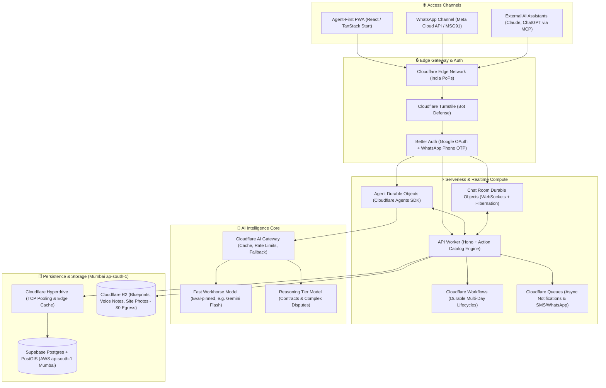
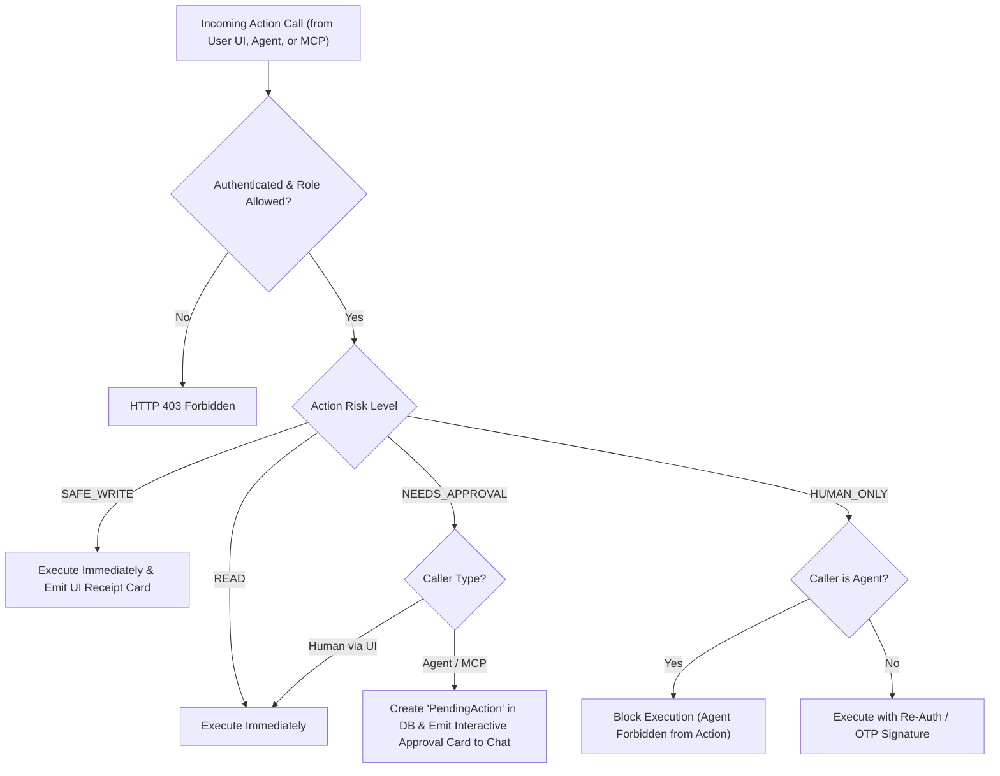
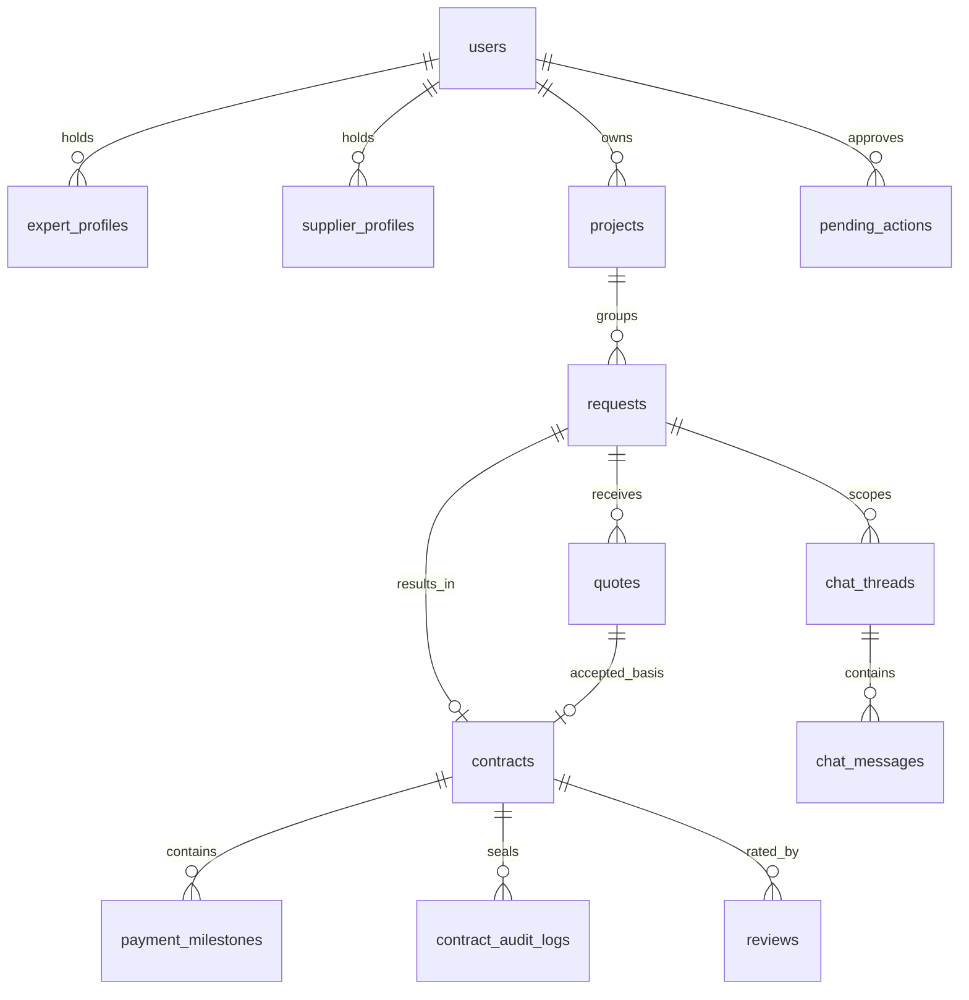
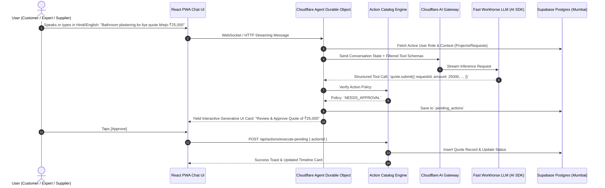

# GEFIFI v3 — Master Architecture Blueprint & Execution Plan
**AI Agentic Construction Marketplace & Workflow Platform**

---

## 1. Executive Summary & Core Paradigm

**GEFIFI v3** is an **Agent-Native Marketplace & Construction Workflow Platform** designed for the Indian construction and home improvement ecosystem. It unites Customers (Visionaries), Experts (Contractors/Builders/Tradespeople), and Material Suppliers under a unified digital umbrella.

### The Paradigm Shift: From "App with a Chatbot" to "Agent-Native Platform"
In v2, the AI assistant was an external Python process trying to puppet an Express REST API by duplicating 25+ hand-written HTTP tools, while human-in-the-loop safety lived only in fragile LLM system prompts.

In v3, **the domain is designed once as a typed Action Catalog**. Humans (via a conversational or visual UI), the internal Gefifi Agent, and external agents (via MCP) all execute the exact same underlying business logic. Crucially, **safety is enforced by the server's policy layer, not LLM obedience**.



---

## 2. Definitive Technology Stack Matrix

| Layer | Selected Technology | Strategic Rationale & Reality Check |
| :--- | :--- | :--- |
| **Monorepo & Package Mgr** | `pnpm` workspaces + **Turborepo** | Strict dependency isolation, zero ghost dependencies, lightning-fast caching across shared packages. |
| **Language** | **TypeScript 5.8+** (Strict mode) | End-to-end type safety from Postgres database columns to React components to Agent Zod schemas. |
| **Edge Compute** | **Cloudflare Workers** + `nodejs_compat` | Zero cold starts, 30+ PoPs across India (Mumbai, Delhi, Bangalore, Chennai), ultra-low edge latency. |
| **Frontend Framework** | **React 19 + React Router v7** *(Recommended)* or **TanStack Start** *(Bleeding-edge)* | **Risk note**: TanStack Start 1.0 shipped October 13, 2026. For a solo dev on a 12-week clock, **React Router v7** (formerly Remix) is the lower-risk, battle-tested choice on Cloudflare Workers. If choosing TanStack Start, freeze dependencies strictly. |
| **Design System** | **Tailwind CSS v4 + shadcn/ui + reui.io** | High-performance glassmorphism aesthetics, accessible primitives, copy-paste modularity. |
| **Database** | **Supabase PostgreSQL (AWS ap-south-1 Mumbai)** | **Correction**: Neon does *not* offer an AWS Mumbai (`ap-south-1`) region (only Singapore `ap-southeast-1`, which adds 40–70ms cross-sea latency). Supabase provides native AWS Mumbai deployment, built-in PostGIS, and integrates with Cloudflare Hyperdrive. |
| **Database Connection** | **Cloudflare Hyperdrive** | Connection pooling and intelligent read caching right at the Indian Cloudflare edge. |
| **Spatial / Geolocation** | **PostGIS Extension (`geography(Point, 4326)`)** | Native spatial distance queries (`ST_DWithin`) for millisecond provider matching within service radius. *Note: `pgvector` is explicitly deferred to post-MVP.* |
| **ORM** | **Drizzle ORM + Drizzle Kit** | Lightweight, zero-overhead, schema-as-code in TypeScript, edge-native compatibility. |
| **Authentication** | **Better Auth (Postgres Session Store)** | 1-click Google OAuth primary login + mandatory WhatsApp OTP phone binding via MSG91. Zero per-user SaaS fees. |
| **Realtime Chat & Presence** | **Cloudflare Durable Objects** | WebSocket hibernation (holds thousands of connections at zero idle cost), ephemeral typing and presence states. |
| **Agent State & Memory** | **Cloudflare Agents SDK** | Persistent SQLite state machine per user session, streaming response protocols, automatic state synchronization. |
| **AI LLM Brain** | **Vercel AI SDK + Cloudflare AI Gateway** (Gemini family) | Model identifier pinned via CI benchmark evals (`LLM_FAST_MODEL` and `LLM_REASONING_MODEL`), not hardcoded in architecture. |
| **LLM Gateway & Proxy** | **Cloudflare AI Gateway** | Prompt caching, per-user rate limits, retry backoffs, model fallback, transparent token analytics. |
| **File & Media Storage** | **Cloudflare R2** | S3-compatible, **$0 egress fees** for high-resolution 4K construction photos, audio voice notes, and PDF blueprints. |
| **Async Queues & Schedulers** | **Cloudflare Queues & Workflows** | Durable multi-day background tasks (quote expiration alerts, contract signing reminders) and notification fan-out. |
| **Notifications** | **Web Push + WhatsApp Cloud API / MSG91** | High-open-rate (~98%) WhatsApp transactional alerts for high-priority contract and quotation milestones. |
| **Error Tracking** | **Sentry (`@sentry/cloudflare` + browser SDK)** | Real-time crash alerting across both edge workers and client browsers. |

---

## 3. The Core Innovation: Unified Action Catalog

Every business operation in Gefifi is written **once** as a typed action in `packages/core/actions/`.

### 3.1. Four-Tier Server-Enforced Risk Policy
Instead of hoping the LLM will follow system prompts, the **API engine strictly enforces risk levels**:



### 3.2. Risk Classification Matrix

| Risk Level | Capabilities | Server Enforcement Behavior |
| :--- | :--- | :--- |
| `READ` | `requests.browse`, `quotes.list`, `profile.get`, `chat.history` | Executes autonomously with zero approval. |
| `SAFE_WRITE` | `requests.createDraft`, `chat.sendMessage`, `quotes.markUnderReview`, `interest.express` | Executes immediately; generates an undo-able receipt in UI. Messages labeled *"via Gefifi Assistant"*. |
| `NEEDS_APPROVAL` | `requests.publish`, `quotes.submit`, `quotes.accept`, `contracts.draft`, `status.progress` | Agent **cannot commit**. Creates a `PendingAction` row. The UI renders an **Interactive Approval Card** with `[Approve]` and `[Reject]` buttons. |
| `HUMAN_ONLY` | `contracts.sign`, `payments.confirmReceipt`, `contracts.dispute`, `admin.*` | Completely inaccessible to AI Agents. Strictly requires human biometric/OTP re-verification. |

### 3.3. Action Definition Example

```typescript
// packages/core/src/actions/quotes/submit-quote.ts
import { z } from "zod";
import { defineAction } from "../../action-runtime";

export const submitQuoteAction = defineAction({
  id: "quote.submit",
  title: "Submit a Quotation",
  description: "Submit a competitive price bid and validity terms for an open expert or material request.",
  roles: ["expert", "supplier"],
  risk: "NEEDS_APPROVAL",
  schema: z.object({
    requestId: z.string().uuid("Invalid request identifier"),
    amount: z.number().positive("Quote amount must be positive"),
    validityDays: z.number().int().min(1).max(90).default(30),
    terms: z.string().min(10, "Provide clear terms and work scope"),
    estimatedDurationDays: z.number().int().positive().optional(),
    attachments: z.array(z.string().url()).max(5).default([])
  }),
  async handler(ctx, input) {
    // 1. Verify request is still open
    // 2. Insert new quote record with versioning (parentQuoteId if revision)
    // 3. Emit timeline event to Chat Room Durable Object
    // 4. Dispatch WhatsApp notification to customer via Cloudflare Queues
    return { quoteId, version, status: "submitted" };
  }
});
```

---

## 4. Domain Data Model & Database Schema

The database uses PostgreSQL with the PostGIS extension, managed via Drizzle ORM.

### 4.1. Entity-Relationship Overview



### 4.2. Core Tables Specification

#### 1. `users` & Profiles
- **`users`**: `id` (UUID), `email`, `phone` (E.164, unique), `phone_verified` (boolean), `name`, `avatar_url`, `created_at`, `status` (`active`, `suspended`).
- **`expert_profiles`**: `id` (UUID), `user_id` (FK), `experience_years`, `categories` (`text[]`), `skills` (`text[]`), `service_location` (`geography(Point, 4326)`), `service_radius_km` (int), `verification_status` (`pending`, `verified`, `rejected`), `badge` (`none`, `verified_pro`).
- **`supplier_profiles`**: `id` (UUID), `user_id` (FK), `company_name`, `material_categories` (`text[]`), `warehouse_location` (`geography(Point, 4326)`), `delivery_radius_km` (int), `verification_status`.

#### 2. `projects` & `requests`
- **`projects`**: `id` (UUID), `customer_id` (FK `users`), `title` (e.g. "2BHK Renovation, Kothrud"), `location` (`geography(Point)`), `city`, `pin_code`, `status` (`active`, `completed`, `archived`).
- **`requests`**: `id` (UUID), `project_id` (FK), `customer_id` (FK), `type` (`expert` | `material`), `title`, `description`, `category` (FK `categories`), `location` (`geography(Point)`), `visibility` (`open` | `invite_only`), `status` (`draft`, `open`, `under_review`, `contracted`, `completed`, `cancelled`), `expiration_date` (timestamp).
- **`request_invites`**: `request_id`, `provider_user_id`, `invited_at`, `status` (`sent`, `viewed`, `declined`).

#### 3. `quotes` (Versioned Bids)
- **`quotes`**: `id` (UUID), `request_id` (FK), `provider_id` (FK `users`), `provider_role` (`expert` | `supplier`), `version` (int, starts at 1), `parent_quote_id` (self-referencing FK for revisions), `amount` (numeric 12,2), `validity_days` (int), `terms` (text), `attachments` (`jsonb`), `status` (`draft`, `submitted`, `revised`, `under_review`, `accepted`, `rejected`, `expired`).

#### 4. `contracts` & Unified Payment Milestones
- **`contracts`**: `id` (UUID), `request_id` (FK), `quote_id` (FK), `customer_id` (FK), `provider_id` (FK), `total_amount` (numeric), `payment_type` (`lump_sum` | `milestone_schedule`), `status` (`draft`, `revision_requested`, `signed`, `in_progress`, `completed`, `disputed`, `terminated`), `customer_signed_at`, `provider_signed_at`, `contract_hash` (SHA-256 string).
- **`payment_milestones`**: `id` (UUID), `contract_id` (FK), `sequence_order` (int), `title` (e.g. "Advance for Material Purchase", "Final Completion Handover"), `percentage` (numeric), `amount` (numeric), `trigger_condition` (`on_signing`, `midway_inspection`, `completion`), `status` (`pending`, `marked_paid_by_customer`, `confirmed_by_provider`, `disputed`), `payment_proof_r2_url`, `transaction_ref`, `paid_at`, `confirmed_at`.
- **`contract_audit_logs`**: `id` (UUID), `contract_id` (FK), `signer_user_id`, `signer_role`, `otp_verified_at`, `ip_address`, `device_fingerprint`, `audit_certificate_r2_url`.

#### 5. `chat_threads` & Durable Object Storage
- **`chat_threads`**: `id` (UUID), `request_id` (FK), `customer_id` (FK), `provider_id` (FK), `last_message_at`, `status` (`active`, `archived`).
- **`chat_messages`**: `id` (UUID), `thread_id` (FK), `sender_id` (FK), `type` (`text`, `voice`, `attachment`, `timeline_event`), `content` (text), `media_url` (R2 URL), `is_agent_generated` (boolean), `created_at`.

#### 6. `pending_actions` (Agent HITL Queue)
- **`pending_actions`**: `id` (UUID), `user_id` (FK), `session_id`, `action_id` (e.g. `quote.submit`), `payload` (`jsonb`), `status` (`pending`, `approved`, `rejected`, `expired`), `expires_at`.

---

## 5. Agent Architecture: Cloudflare Agents SDK + Dual-Tier LLM

Each authenticated user conversation is powered by a **Stateful Cloudflare Agent Durable Object**:



### 5.1. MVP Agent Action Scope (Reality Check & Pruning)
In v2, the tracker cataloged ~39 total actions across roles, with only ~20 partially built for customers and virtually none for experts/suppliers. Trying to expose all 39 capabilities through the Agent in a 12-week solo MVP is an anti-pattern.

For MVP, the **Agent Tool Registry is strictly constrained to 9 High-Value Core Actions**:
- **Customer Agent (4 actions)**: `request.create`, `request.browse`, `quote.compare`, `contract.draft`
- **Expert & Supplier Agent (3 actions)**: `request.browseMatching` (via PostGIS), `interest.express`, `quote.submit`
- **Common Utility (2 actions)**: `chat.sendMessage`, `profile.get`

*All other actions* (contract revisions, payment confirmations, disputes, status updates) are completed via **direct Web UI buttons / dialogs**. The agent can deep-link users to those screens but does not require custom tool orchestrators in Week 11.

### 5.2. LLM Model Selection Strategy
- **Framework**: Vercel AI SDK (`ai`) wrapped in Cloudflare AI Gateway.
- **Model Decoupling**: Models are configured via environment variables (`LLM_FAST_MODEL` and `LLM_REASONING_MODEL`).
- **Pinning Rule**: The specific model (e.g. `gemini-3.5-flash-lite`, `gemini-3.1-flash-lite`, or next-gen) is pinned only after executing the CI automated evaluation suite on a golden dataset of 50 Indian construction scenarios (measuring JSON tool compliance, Hindi code-mixing, and latency).

### 5.3. Proactive Nudges via Cloudflare Workflows
Background crons check:
1. **Quote Expiration in 48 Hours**: Alerts customer with comparison summary.
2. **Pending Signature > 24 Hours**: Alerts provider via WhatsApp and in-app banner.
3. **Daily Provider Digest**: Scans PostGIS for open requests within provider's radius and presents a consolidated shortlist in morning chat.

---

## 6. Monorepo Structure (`pnpm` + Turborepo)

```text
gefifi/
├── .github/
│   └── workflows/
│       ├── ci.yml               # Lint, Typecheck, Unit Tests, Agent Evals
│       └── preview-deploy.yml   # Wrangler Preview per PR
├── apps/
│   ├── web/                     # React 19 (React Router v7 / TanStack Start)
│   │   ├── app/                 # Routes: /(auth), /(app)/agent, /requests, /contracts
│   │   ├── wrangler.jsonc       # Cloudflare Pages / Workers SSR config
│   │   └── package.json
│   ├── api/                     # Hono HTTP Edge API Worker
│   │   ├── src/routes/          # Auth, Requests, Quotes, Contracts, Uploads
│   │   ├── wrangler.jsonc
│   │   └── package.json
│   └── agent/                   # Cloudflare Agents SDK Worker
│       ├── src/                 # Agent Durable Object definition, AI SDK bindings
│       ├── wrangler.jsonc
│       └── package.json
├── packages/
│   ├── core/                    # Pure TypeScript Domain Logic & Action Catalog
│   │   ├── src/actions/         # Core 9 MVP actions + direct UI actions
│   │   ├── src/policies/        # Role & permission validation
│   │   └── package.json
│   ├── db/                      # Supabase Postgres + Drizzle ORM
│   │   ├── src/schema/          # Drizzle tables (users, requests, quotes, contracts)
│   │   ├── drizzle/             # SQL Migrations
│   │   └── package.json
│   ├── ui/                      # Shared React Design System & Generative UI Cards
│   │   ├── src/components/      # Approval Cards, Quote Comparators, Chat Stream
│   │   └── package.json
│   └── tsconfig/                # Strict Shared TypeScript configurations
├── turbo.json
├── pnpm-workspace.yaml
└── package.json
```

---

## 7. Milestone-Driven Execution Roadmap & Quality Gates

With the artificial deadline removed, we prioritize **architectural durability, rock-solid security, and supply-side liquidity** over rushed code.

```mermaid
gantt
    title Gefifi v3 — Milestone-Driven Architecture Roadmap
    dateFormat  YYYY-MM-DD
    section Foundation & Data
    M0 : Monorepo Setup & CI/CD Pipeline          :done, m0, 2026-10-20, 7d
    M1 : Supabase PostGIS, Auth & Action Catalog  :active, m1, after m0, 14d
    section Core Marketplace
    M2 : Requests, Discovery & Versioned Quotes   :m2, after m1, 21d
    M3 : Contracts & Cryptographic Dual-OTP Signing:m3, after m2, 21d
    section Asymmetric Supply Channel
    M4 : WhatsApp Inbound Webhooks & Mobile Cards :m4, after m3, 21d
    section Agent & Realtime
    M5 : Durable Objects Chat & Core Agent DOs    :m5, after m4, 21d
    section Quality & Launch
    M6 : Phased Admin, Safety Evals & Hardening   :m6, after m5, 14d
```

### Milestone 0: Monorepo & Tooling Setup
- Initialize `pnpm` workspace + Turborepo + TypeScript 5.8 configurations.
- Configure Cloudflare Wrangler for `apps/web`, `apps/api`, and `apps/agent`.
- Provision **Supabase PostgreSQL (AWS ap-south-1 Mumbai)** and enable PostGIS extension.
- Configure Cloudflare Hyperdrive connection pooling to the Mumbai database.
- Document **Cloudflare Exit Ramps** (Docker/Node, AWS S3, Redis fallbacks) in `docs/exit-ramps.md`.

### Milestone 1: Authentication, Data Schema & Action Runtime
- Author complete Drizzle ORM schema for all tables and run baseline migration.
- Configure Better Auth in `apps/api`: Google OAuth login + WhatsApp OTP verification (MSG91 / Meta Cloud API).
- Implement the `defineAction()` runtime in `packages/core` with server-side 4-tier risk policy enforcement.
- Build pre-signed R2 direct-upload endpoints for media and documents ($0 egress).

### Milestone 2: Core Marketplace Workflows
- Projects, Expert Requests & Material Requests. Implement PostGIS distance query (`ST_DWithin`) for location matching. Request invitation system.
- Quotation engine with versioning (`parentQuoteId`), revision trees, and cascading auto-rejection of competing bids on acceptance.

### Milestone 3: Contracts & Cryptographic Signing (Net-New Feature)
- Contract drafting state machine, lump-sum / milestone payment schedule generator.
- Implement native SHA-256 cryptographic terms hashing, dual WhatsApp OTP re-verification, and PDF audit certificate generation (`pdf-lib`).
- Milestone payment timeline tracking with offline UPI screenshot and reference upload.

### Milestone 4: Asymmetric Channel (WhatsApp + 1-Tap Signed Mobile Cards)
- Build `apps/whatsapp` webhook listener for Meta Cloud API / MSG91: handles text bids and Hindi voice notes (transcribed via Gemini).
- Build featherweight `apps/mobile-cards` server-rendered HTML views (<40KB total) authenticated via HMAC-SHA256 signed magic URLs.
- Allow experts to view separate cards for each customer lead without thread mixing.

### Milestone 5: Realtime Chat & Gefifi Agent Core
- Implement `ChatRoom` Cloudflare Durable Object supporting WebSockets with hibernation.
- Thread scoping per `request × provider` with audio voice notes and automated system timeline cards.
- Deploy Cloudflare Agents SDK Worker using Vercel AI SDK via Cloudflare AI Gateway.
- Auto-generate Agent tools for the **Core 9 MVP Actions** from the `packages/core` Action Catalog.
- Render interactive Generative UI cards in TanStack Start / React Router v7 (`PendingAction` review cards).
- Configure Cloudflare Workflows for 48h quote expiry warnings, 24h signature reminders, and daily provider request digests.

### Milestone 6: Phased Admin Panel, Safety Evals & Launch Hardening
- Build MVP Admin features: Provider document verification, account suspension, dispute review timeline view, and category manager.
- Implement automated golden-turn eval suite in CI testing agent safety (ensuring agent never executes `NEEDS_APPROVAL` or `HUMAN_ONLY` actions directly).
- Run production model eval to pin `LLM_FAST_MODEL` identifier.
- Production domain cutover, Cloudflare Turnstile bot protection, Sentry monitoring verification.

---

## 8. Post-MVP Growth Vector (Months 4+)
1. **Full WhatsApp Autonomous Agent**: Direct two-way conversational access via WhatsApp without opening the web browser.
2. **Escrow Payment Integration**: Razorpay Route / Cashfree Escrow with automatic milestone payouts upon dual sign-off.
3. **Python CAD/Blueprint Extraction**: Cloudflare Container microservice running `ezdxf` to extract bill of quantities (BOQ) and square footage directly from uploaded blueprints.
4. **React Native / Expo Mobile App**: Reusing `packages/core` and `packages/db` types directly.
