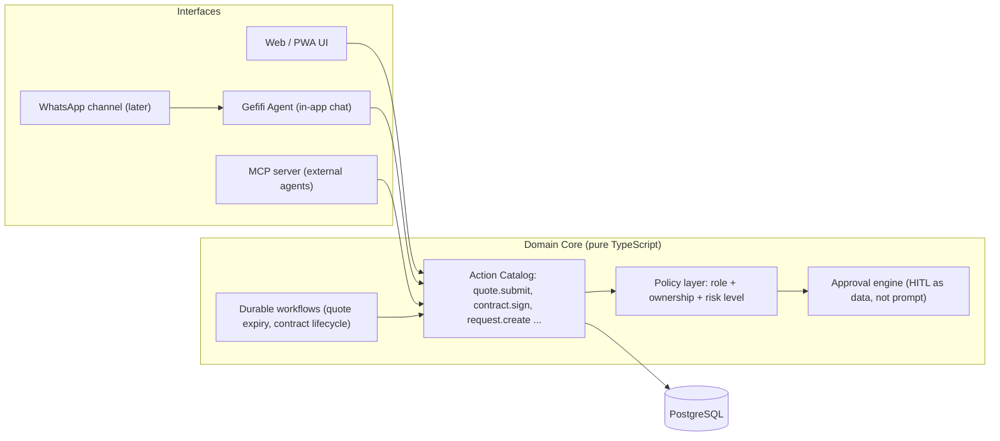
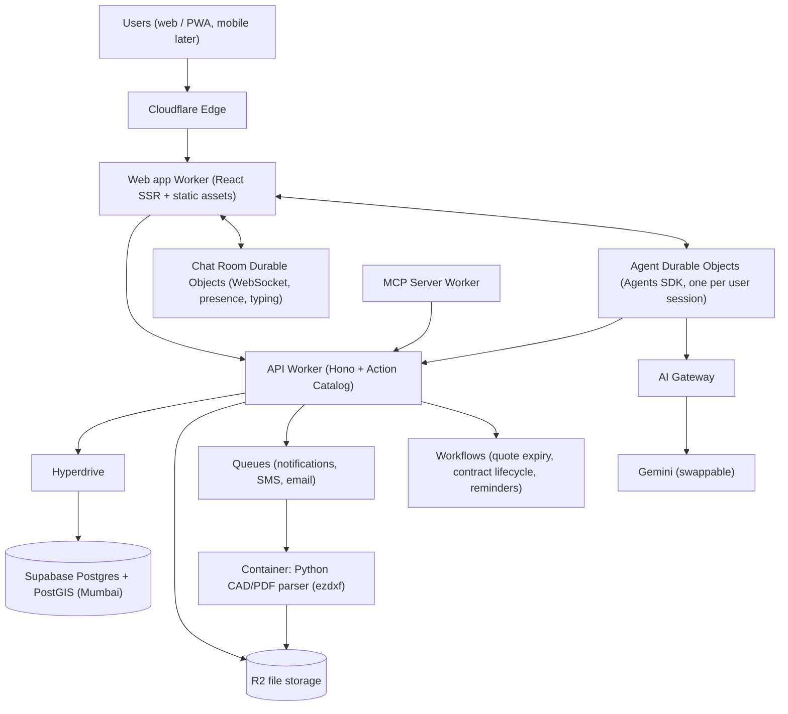

# Gefifi v3 — Agent‑Native Re‑architecture Strategy

> [!NOTE]
> This guide is written for **Gefifi as it exists today**: a construction marketplace in India with 3 roles (Customer / Expert / Supplier), requests, versioned quotes, a contract state machine with signatures, realtime chat (voice, files, presence) and a Python ADK assistant with about 25 hand-written tools.
> **Status: a draft to discuss. Nothing here is final until we confirm the open questions at the end.**

---

## 1. Diagnosis — what is actually wrong today

Before rewriting, be clear about *why*. A rewrite only pays off if it fixes structural problems, not cosmetic ones.

| # | Structural problem in v2 | Symptom you've already hit |
|---|---|---|
| 1 | **Relational data in a document DB** (Firestore). Requests ↔ quotes ↔ contracts ↔ users ↔ chats are deeply relational, with state machines and money. | Cascading "accept quote → reject others → update request → post chat message" is fragile; querying/filtering is limited; the agent filters on the client side (`get_active_*` tools). |
| 2 | **Three runtimes**: Svelte (TS), Express (TS/Bun), ADK agents (Python). | Every capability is written twice: once as a REST route, then again as a Python `httpx` tool wrapper (25+ tools). Bugs like the `${expert_request_id}` JS template in Python come from this. |
| 3 | **The agent is bolted on**, not built in. It can only do what someone remembered to wrap. | Coverage matrix full of 🔧 "automatable but not built". Agent hidden for experts and suppliers. |
| 4 | **No durable workflows.** Multi-step processes (quote → contract → sign → execute → complete) live in ad-hoc route handlers. | No retries, timeouts, reminders ("quote expires in 2 days"), or audit trail. |
| 5 | **Human-in-the-loop is only in the prompt.** HITL relies on the LLM choosing to ask before acting. | The safety is a matter of LLM behaviour, not something the system enforces. |
| 6 | Platform sprawl: Firebase + GCP Cloud Build + an ICP canister (`canister_ids.json`) + Docker. | Ops overhead with no clear owner. |

**Conclusion:** A re‑architecture *is* justified. Problems 1, 2, 3 and 5 can't be fixed with small, gradual changes.

---

## 2. The core idea: "Agent‑native" means one action catalog, many interfaces

In the agentic era, **every capability of Gefifi should be a typed, permission-checked action**. Humans (through the UI), your own agent and external agents (ChatGPT, Claude or Gemini through MCP) should all use the same actions.



You define each action **once**:

```ts
export const submitQuote = defineAction({
  name: "quote.submit",
  description: "Submit a quote on an open work or material request",
  input: z.object({
    requestId: z.string(),
    amount: z.number().positive(),
    validityDays: z.number().int().default(30),
    terms: z.string().optional(),
  }),
  roles: ["expert", "supplier"],
  risk: "needs_approval", // agent can DRAFT; a human must CONFIRM. Enforced by the server, not the prompt.
  async run(ctx, input) { /* business logic + DB transaction + emit event */ },
});
```

From that one definition you generate:
- an **RPC/HTTP endpoint** for the UI (end‑to‑end typed),
- an **agent tool** (the Zod schema becomes the tool schema, with no hand-written wrapper),
- an **MCP tool**, so users can say "Gefifi, show me new plumbing jobs in Pune" from any AI assistant,
- an **audit log entry** for every call (who, which interface, approved by whom).

**Risk levels** replace prompt-based HITL:

| Risk | Examples | Agent behaviour (enforced by the server) |
|---|---|---|
| `read` | browse requests, view quotes | runs freely |
| `safe_write` | create a draft request, mark a quote under review, send a chat message | runs, and the action is shown in the chat |
| `needs_approval` | submit or accept a quote, draft a contract, change status | creates a **PendingAction**, and the UI shows an approve/reject card |
| `human_only` | sign contract, release payment, mark complete | the agent can't call it at all |

This one idea removes the 25-tool duplication, makes HITL safe and gives you external agent access almost for free.

---

## 3. Technology verdicts (your list, reviewed)

| Category | Your candidates | Verdict | Why |
|---|---|---|---|
| **Language** | Go, Rust, TypeScript | ✅ **TypeScript only** (frontend, backend and agent). ❌ Rust. ⏸ Go. | One language means shared types and schemas from DB to UI to agent tools. TS has the strongest agent ecosystem next to Python, and AI coding agents are most productive in TS. Rust gives raw speed you don't need for a CRUD + chat marketplace and costs a lot of dev time. Go is excellent but splits the type system. |
| **Backend framework** | NestJS, Encore.ts | ❌ NestJS, ❌ Encore.ts → ✅ **Hono on Cloudflare Workers** | NestJS is heavy, decorator-based and a poor fit for Workers. Encore.ts is nice but deploys to AWS/GCP, not Cloudflare. Hono is tiny, fast and native to Workers. |
| **Database** | PostgreSQL, Convex | ✅ **PostgreSQL + PostGIS** (Mumbai `ap-south-1`), ❌ Convex | Your data is relational, transactional and involves money and contracts. Postgres is the right choice for 10+ years. Convex is great for realtime, but you'd add a second vendor to Cloudflare. Durable Objects cover realtime (see below). *Note: `pgvector` is explicitly deferred to post-MVP; PostGIS spatial radius matching is used for MVP.* |
| **ORM** | — | ✅ **Drizzle** | Lightweight, runs on Workers, schema in TS, SQL-like. |
| **Message brokers** | RabbitMQ, Kafka | ❌ **Not now.** ✅ Cloudflare **Queues** + **Workflows** | Kafka and RabbitMQ are servers you have to run, and they solve problems at a scale you don't have. Queues handles async jobs (notifications, SMS, emails). Workflows gives durable, multi-step, retryable processes with sleeps ("remind in 48h"). Revisit Kafka only if you reach very high event volumes or need a separate data or analytics team. |
| **Error reporting** | Sentry | ✅ **Keep** | `@sentry/cloudflare` plus the browser SDK. Cheap and essential. |
| **Observability** | Prometheus, Grafana | ⏸ **Later.** ✅ Workers Observability + Sentry + AI Gateway now | Prometheus is pull-based and doesn't fit serverless. Start with built-in Workers logs and traces. Export OpenTelemetry to Grafana Cloud when you need dashboards and SLOs. |
| **LLM observability** | (missing) | ✅ **Cloudflare AI Gateway** (+ Langfuse optional) | Caching, rate limits, model fallback, cost tracking per user. Important for controlling cost. |
| **Agent framework** | "Agent" | ✅ **Cloudflare Agents SDK + Vercel AI SDK**, Gemini models | Each conversation is a Durable Object with built-in state, WebSockets, scheduling and MCP support. The AI SDK keeps you model-agnostic (eval-pinned model via env vars). Python ADK is retired (see Risks). |
| **Frontend** | React, Next.js, SvelteKit | ✅ **React + React Router v7** *(Battle-tested)* or **TanStack Start** *(Bleeding-edge)* | reui.io and shadcn/ui are **React** libraries. The agent UI ecosystem (AI SDK UI, Agents SDK React hooks, AI chat components) is React-first. *Warning*: TanStack Start 1.0 shipped October 13, 2026. For a solo 12-week MVP, React Router v7 is lower risk. |
| **UI kit** | reui.io, shadcn/ui | ✅ **shadcn/ui as the base + reui.io components** | Both are copy-paste, Tailwind-based and compatible. |
| **Cloud** | Cloudflare | ✅ **Cloudflare** + **Supabase Postgres (Mumbai ap-south-1)** | Good fit (see §4). Neon has *no* AWS Mumbai region (only Singapore `ap-southeast-1`), so Supabase (or AWS RDS) in Mumbai is required to avoid cross-sea latency. Connected via **Hyperdrive**. |
| **Auth** | (Firebase Auth today) | ✅ **Better Auth** (data stored in your Postgres) | Phone OTP, Google, sessions, orgs. No per-user vendor fees. Use **MSG91** (or WhatsApp OTP) instead of Twilio for Indian SMS. It's cheaper and handles DLT registration. |
| **Files** | (Firebase Storage) | ✅ **Cloudflare R2** | No egress fees. Good for DWG, PDF and image-heavy construction data. |

---

## 4. Target architecture on Cloudflare



| Concern | Cloudflare primitive |
|---|---|
| Compute | Workers (auto-scaling, many PoPs in India, no cold starts to speak of) |
| Realtime chat, presence, typing | Durable Objects with WebSocket hibernation (replaces Firestore listeners) |
| Agent memory and state | Agents SDK (Durable Objects + embedded SQLite) |
| Long-running business processes | Workflows |
| Async jobs | Queues |
| Files | R2 (+ Images for thumbnails) |
| DB connection pooling and caching | Hyperdrive |
| Bot protection | Turnstile |
| Heavy or non-JS work (DWG parsing) | Containers. **This is the only place Python stays.** |

---

## 5. Will it be scalable, durable, fast and quick to build?

| Goal | Answer | Honest caveat |
|---|---|---|
| **Scalable** | Workers and DOs scale horizontally on their own. One chat room is one DO, so chat scales linearly. | Postgres becomes the bottleneck eventually (likely beyond millions of users). Add read replicas then. |
| **Durable** | Postgres for truth, R2 for files, Workflows for processes that survive crashes and deploys, plus an audit log for every action. | You must design idempotent actions. That's part of the action catalog pattern. |
| **Fast** | Edge SSR, Hyperdrive query caching, DB in Mumbai near your users, WebSockets for chat. | Keep DB-heavy Workers close to the DB (Smart Placement). Workers at the edge won't help if every request crosses continents to the DB. |
| **Low dev time** | One language, one repo, one action definition becomes UI + agent + MCP. AI coding agents work best on typed TS monorepos. | The first 2–3 weeks (foundation and action framework) feel slow. Everything after is faster. |

---

## 6. DevOps & engineering method

| Area | Recommendation |
|---|---|
| **Repo** | Monorepo (`pnpm` workspaces + Turborepo): `apps/web`, `apps/api`, `apps/agent`, `packages/core` (actions, domain), `packages/db` (Drizzle schema), `packages/ui` |
| **Branching** | Trunk-based development, short-lived branches, squash merge |
| **CI/CD** | GitHub Actions: typecheck → lint → unit tests → **agent evals** → deploy. Use `wrangler`. |
| **Environments** | `preview` (per PR) → `staging` → `production` |
| **Releases** | Workers gradual deployments (e.g. 10% → 100%) + feature flags |
| **Infra as code** | `wrangler.jsonc` per app. Terraform or Pulumi only for DNS and account-level resources, and only if needed. |
| **DB migrations** | Drizzle Kit, run in CI, always backwards-compatible (expand → migrate → contract) |
| **AI-specific** | Prompt and agent versioning, a golden-conversation **eval suite in CI** (e.g. "expert submits quote → must produce PendingAction, never a direct write"), per-user token budgets through AI Gateway |
| **AI-assisted dev** | `AGENTS.md` at the repo root, spec-first features (a short spec, then the agent implements, then a human reviews). Strong types and tests act as guardrails for AI-written code. |

---

## 7. Execution plan (phased, not big-bang)

> [!IMPORTANT]
> Durations assume **1 developer working with AI coding agents** on a fresh v3 (no legacy production migration needed).

| Phase | Duration | Deliverable | Exit criteria |
|---|---|---|---|
| **0. Setup** | 1 wk | Monorepo (`pnpm` + Turbo), Wrangler configs, Supabase Postgres (Mumbai ap-south-1) + PostGIS, Hyperdrive | Preview deploys working, DB connected |
| **1. Foundation** | 2 wks | Drizzle schema, Better Auth (Google + WhatsApp phone OTP), Sentry, UI design tokens, `defineAction` 4-tier risk runtime | User can log in, sample action executes safely |
| **2. Core marketplace** | 4 wks | Projects, Expert/Material requests, PostGIS radius discovery, Quotes (versioned), Contract state machine, **Net-new**: SHA-256 terms hash + dual WhatsApp OTP re-verification + PDF audit certificate | All core procurement and contracting flows pass end-to-end |
| **3. Realtime** | 2 wks | Chat Room DOs (WebSocket hibernation, R2 audio notes, presence, typing, automated timeline cards) | Responsive realtime chat per deal |
| **4. Agent** | 2 wks | Cloudflare Agents SDK + AI Gateway for **Core 9 MVP Actions**, PendingAction generative UI cards, automated CI eval suite | Agent accurately drafts requests/quotes with zero unapproved writes |
| **5. Phased Admin & Launch** | 1 wk | Provider verification, user suspension, dispute view, category manager, Turnstile, production cutover | v3 live in production |
| **Later** | — | WhatsApp agent channel, Escrow payouts (Razorpay/Cashfree), Expo mobile app, Python CAD parsing container | Post-MVP roadmap |

---

## 8. Risks & trade-offs

> [!WARNING]
> **Cloudflare lock-in.** Durable Objects, Workflows and Agents SDK are Cloudflare-only. **Mitigation:** keep `packages/core` as pure TypeScript with no Cloudflare imports. Platform code stays in thin adapters. Postgres and R2 (which is S3-compatible) are portable.

- **Retiring the Python ADK work.** The *logic* you built (role routing, smart defaults, guardrails, fallbacks) carries over. Only the language changes. Role routing becomes trivial because the policy layer already knows the user's role.
- **Workers aren't full Node.** `nodejs_compat` covers most libraries. Heavy native libraries (CAD parsing) go to Containers.
- **Second-system syndrome.** Don't add features during the rewrite. Reach parity first (minus anything you've already deleted, like Projects), then innovate.
- **Agents SDK changes fast.** Pin versions and keep agent code behind your own small interface.

---

## 9. Decisions I need from you

1. **Team and timeline.** How many developers, and is there a target launch date?
2. **Production data.** Does v2 have real users or data that must be migrated, or can v3 start fresh?
3. **React or Svelte.** Your UI choices (reui, shadcn) imply React. Are you OK leaving Svelte?
4. **Budget.** Is there a monthly infra limit? (Early-stage estimate: tens of USD/month for infra, excluding LLM tokens and SMS.)
5. **Mobile and WhatsApp.** Are experts and suppliers mostly on Android and WhatsApp? If yes, a WhatsApp agent channel could matter more than the web UI.
6. **Payments.** Is escrow or in-app payment on the roadmap? It affects the domain model now, even if we build it later.
